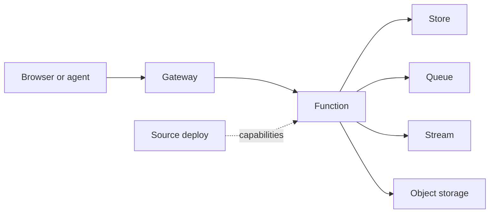

Coding agents write backend code faster than anyone can audit line by line, so
Ferrite puts the security boundary in the application contract. Each application
is one Rust crate paired with a `ferrite.json` manifest that declares every
store, queue, stream, object store, route, secret, and outbound destination the
code uses. The platform checks the source, builds the binary itself, and injects
handles only for what the manifest names.

Your coding agent operates the platform through the `ferrite` CLI or MCP tools,
from local validation through deploys, forks, and rollbacks, inside an account
you own. The agent writes the Rust; you audit one manifest to see everything
that code can reach.

Behind one SDK, Ferrite provides six primitives: a key-value store, ordered
streams, queues, multi-key transactions, object storage, and isolated functions.
A gateway, capability system, deployment pipeline, and operational tools bind
them into a complete runtime. Source packages vendor application-level features
straight into your crate, such as provider sign-in through the `auth` package.

## What you can build

Build request-driven web applications, HTTP APIs, background workers,
multi-step [workflows](/developers/workflows/) composed from queues and
transactions, event streams, agent backends, and MCP servers. Applications whose
state fits the key-value store, queues, streams, and object storage run directly
on Ferrite with no external database, message broker, object store, or scheduler
to manage.

## Six primitives, one application contract

| Developer need | Ferrite primitive | What it provides |
| --- | --- | --- |
| Small records | [Key-value Store](/developers/store/) | Linearizable reads and writes, CAS, ADD, TTL, scans |
| Ordered events | [Streams](/developers/streams/) | Dense offsets, retention, replay, consumer groups |
| Background work | [Queues](/developers/queues/) | Leases, retries, delayed delivery, dead letters |
| Atomic changes | [Transactions](/developers/transactions/) | One commit decision across up to 64 keys |
| Files and large values | [Object Storage](/developers/object-storage/) | Content-addressed blobs and verified reads |
| Application code | [Functions](/developers/functions/) | Supervised processes with bounded memory and CPU |

The five durable primitives share one replication, identity, and audit model, so
you avoid wiring separate services with conflicting failure and permission
semantics.

## A request through Ferrite



The Gateway terminates public traffic and passes a typed request to your
function. Your handlers pull injected handles from `AppContext`; they have no
ambient database credentials and cannot open raw sockets. Outbound HTTP travels
through the gateway only to URL prefixes declared in `ferrite.json`, and every
attempt is logged.

## Start locally

```bash
ferrite new webapp hello-ferrite --with-tests
cd hello-ferrite
ferrite dev
```

`ferrite dev` starts local implementations of Ferrite's services, prints a
clickable URL, preserves state across rebuilds, recompiles Rust on source edits,
and refreshes the browser when content changes. Local checks are advisory; run
`ferrite check --remote` or a preview deploy for the platform's own verdict.
Continue with the [Quickstart](/developers/quickstart/) or read the full
[Ferrite CLI](/developers/cli/) workflow.

## What it costs

Ferrite bills against a prepaid balance at metered rates, with no plan fee and
no seat fee. A small always-on application costs roughly $8 a month. Run
`ferrite cost` (MCP: `estimate_cost`) before deploying to inspect your balance,
the deploy fee, and each application's projected monthly rate; it charges
nothing and deploys nothing.

Deploys that exceed the available balance are refused (`INSUFFICIENT_CREDIT` in
the CLI, `InsufficientCredit` in MCP). When a funded account hits zero, its
applications stop and remain preserved for 30 days before permanent deletion
with their data.

Trial accounts last 48 hours, start with $5 of credit, and run one instance per
application at 256 MiB of memory and half a CPU. Their applications suspend when
the trial credit runs out, and go offline after 48 hours unless someone signs in
to keep the account; after signing in, you buy more credit in the Dashboard. See
[Understand usage and credits](/kb/guide/usage-and-credits/) for balance
tracking, statements, and top-ups.

## Security and scale

Before any build runs, the platform validates the manifest and static source
rules. Static validation filters disallowed code early, while OS containment
enforces the runtime boundary. Applications share the host kernel, and Ferrite's
application host launches each instance as its own unprivileged user inside
private kernel namespaces with no network route of its own, behind a system-call
filter and under hard memory and CPU limits. Read
[What bounds your app](/developers/why-it-is-safe/) for each layer, what is
shared, and what stays in your hands.

The platform bounds what an application can reach; your code controls which
users may see which records. Sign-in proves identity, and your handlers decide
who can view an order, administer a booking calendar, or trigger a release.

Gateways are stateless and scale horizontally. Durable services run fenced
replication with verified rejoin, and workers rely on leases and idempotency so
crashes redeliver work instead of dropping it.

## From prototype to a product people use

An inventory reservation, a reminder pipeline, and a support agent all need
state that survives retries, verified user identity, and operational logs that
explain failures. Ferrite supplies those primitives under the same application
contract.

When your application serves end users, run `ferrite add auth` to vendor the
[`auth` package](/developers/authentication/) for Google or GitHub sign-in and
an access list. Use [logs and usage telemetry](/developers/logs/) to trace
requests and [state forks](/developers/environments/#state-forks) to test
changes against an isolated copy of live data. Add the `agent-ready` source
package to describe your operations once and expose them to customers'
assistants over MCP and HTTP under the same authorization rules as your web UI.

## Next steps

- [Create and run your first app](/developers/quickstart/)
- Connect your coding agent through [Agent setup](/developers/plugin/) for CLI and MCP access
- [See complete apps](/developers/apps/) for commerce, scheduling, support, and compliance patterns
